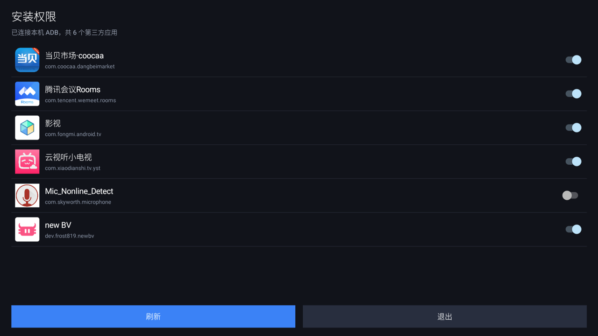

# 安装权限 · TV Install Permission Manager

一个运行在 Android TV 上的小工具：通过设备本机的 ADB 通道，给所有第三方应用批量管理“安装应用”权限（`REQUEST_INSTALL_PACKAGES`）。

主要解决部分创维 / 酷开电视隐藏了安装权限菜单，导致影视、当贝市场等应用无法安装 APK 的问题。

## 功能

- 自动连接本机 ADB（`127.0.0.1:5555`），无需电脑持续连接。
- 列出所有第三方应用，并显示应用名称、包名和图标。
- 每个应用右侧有开关，切换后立即写入 `appops` 并生效。
- ADB 未连接时弹窗提示，可一键跳转到工厂菜单的“通用设置”手动打开 ADB。
- 每 3 秒自动重试连接，ADB 恢复后自动连接并刷新列表。
- 支持电视遥控器焦点导航，底部提供“刷新”和“退出”按钮。

## 截图



## 工作原理

1. App 内置了一个精简 ADB 客户端，通过 `127.0.0.1:5555` 连接本机 `adbd`。
2. 首次连接时自动生成 RSA 密钥并完成 ADB 认证，密钥保存在应用私有目录。
3. 读取 `appops get <包名> REQUEST_INSTALL_PACKAGES` 初始化开关状态。
4. 切换开关时执行 `appops set <包名> REQUEST_INSTALL_PACKAGES allow|default`。
5. 权限最终写入 `/data/system/appops.xml`，日常使用不依赖外部电脑。

## 适用环境

- Android 5.0（API 21）及以上的 Android TV。
- 电视已打开本机 ADB TCP 调试端口，默认端口为 `5555`。
- ROM 支持 `appops` 命令；创维 / 酷开可进入工厂菜单打开 ADB 的场景已实测。

## 构建

### 依赖

- JDK 8 或更高版本，需要 `javac`、`jarsigner`、`keytool`。
- [apktool](https://ibotpeaches.github.io/Apktool/) 2.11 或更高版本。
- R8 的 `r8.jar`。
- 一个 `android.jar`（任意较新版本的 Android SDK 平台包即可）。

### 准备 SDK 文件

`sdk/` 目录默认被 `.gitignore` 忽略，需要自行准备：

```bash
mkdir -p sdk/android-13

# 如果本机已有 Android SDK：
cp "$ANDROID_HOME/platforms/android-33/android.jar" sdk/android-13/android.jar

# 下载 R8：
curl -fL -o sdk/r8.jar \
  https://repo1.maven.org/maven2/com/android/tools/r8/8.2.42/r8-8.2.42.jar
```

也可以通过环境变量覆盖默认路径：

```bash
export ANDROID_JAR=/path/to/android.jar
export R8_JAR=/path/to/r8.jar
```

### 执行构建

```bash
./scripts/build.sh
```

构建成功后，安装包位于：

```text
dist/adbperm.apk
```

该安装包使用本地自动生成的 debug 签名，仅用于自行安装测试。

## 安装到电视

```bash
adb connect 电视IP:5555
adb install -r dist/adbperm.apk
```

## 使用说明

1. 打开电视上的“安装权限”。
2. 如果提示 ADB 未连接，点击“打开 ADB”，进入工厂菜单的“通用设置”，手动打开 ADB 开关。
3. 返回 App 后，它会每 3 秒自动重试，ADB 恢复后自动连接并刷新。
4. 在应用列表右侧点击开关，即可立即允许或还原对应应用的安装权限。
5. 底部“刷新”重新读取列表，“退出”关闭 App。

## 项目结构

```text
.
├── AndroidManifest.xml
├── res/
│   ├── drawable/ic_launcher.png
│   └── values/strings.xml
├── src/com/hz/adbperm/
│   ├── AdbClient.java
│   └── MainActivity.java
├── scripts/
│   ├── build.sh
│   └── make_icon.py
└── docs/screenshot.png
```

## 注意事项

- 请只在你拥有或有权管理的设备上使用本工具。
- 不同电视 ROM 的工厂菜单入口和名称可能不同；本仓库中的 `skyworth.intent.action.FACTORY` 主要针对创维 / 酷开。
- 仓库不包含签名密钥、`android.jar` 和 `r8.jar`，构建产物请自行保管。

## License

[MIT](LICENSE)
